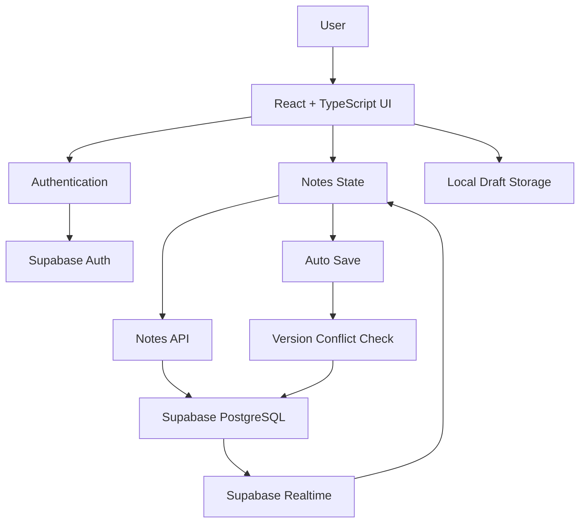

# Little Notes

A cozy full-stack note-taking application built with **React, TypeScript, Supabase, and Tailwind CSS**.

Little Notes focuses on a smooth writing experience across devices, with real-time synchronization, automatic saving, conflict protection, drag-and-drop organization, bilingual UI support, and responsive design.

## Live Demo

[Try Little Notes](https://little-notes-nine.vercel.app)

## Features

- User authentication
- Create, edit, delete, and pin notes
- Real-time synchronization across sessions
- Automatic saving while editing
- Local draft recovery
- Version-based conflict detection
- Search and filter notes
- Drag-and-drop note ordering
- Calendar-based note organization
- Responsive mobile interface
- Light and dark themes
- English / Chinese language switching
- Password recovery flow

## Tech Stack

### Frontend

- React
- TypeScript
- Tailwind CSS
- Vite
- dnd-kit

### Backend / Database

- Supabase
- PostgreSQL
- Supabase Authentication
- Supabase Realtime

### Deployment

- Vercel

## Architecture



The frontend manages the user's editing state locally while Supabase provides authentication, cloud persistence, and real-time database updates.

Each note includes a version value used to detect stale updates before saving changes to the cloud.

## Real-Time Synchronization

Little Notes listens for database changes through Supabase Realtime.

When a note is created, updated, or deleted in another session, the application can synchronize those changes without requiring a page refresh.

To avoid overwriting active edits, remote updates are handled differently when a note has unsaved local changes.

Conceptually:

```text
Device A edits note
        |
        v
Supabase database
        |
        v
Realtime event
        |
        v
Device B receives update
```

## Auto-Save

Notes are automatically saved after the user stops typing.

Instead of sending a database request after every keystroke, Little Notes uses a short debounce period before saving.

```text
User types
    |
    v
Wait briefly
    |
    v
No additional input?
    |
    +---- No ---> Restart timer
    |
   Yes
    |
    v
Save note
```

This reduces unnecessary database writes while keeping the writing experience responsive.

## Conflict Protection

A major challenge in a real-time notes application is preventing one session from accidentally overwriting a newer version saved somewhere else.

Little Notes uses version-based optimistic concurrency control.

Example:

```text
Device A loads Note Version 5
Device B loads Note Version 5

Device A saves
Version becomes 6

Device B attempts to save Version 5
        |
        v
Conflict detected
```

Instead of silently overwriting the newer cloud version, the application can preserve the user's local draft and handle the conflict safely.

## Local Draft Recovery

Unsaved editing state can be preserved locally.

This helps protect work if:

- the network temporarily fails
- a cloud save does not complete
- the page is refreshed unexpectedly
- a conflict occurs during synchronization

The application can recover the local draft rather than immediately discarding the user's changes.

## Drag-and-Drop Organization

Little Notes uses **dnd-kit** for drag-and-drop note organization.

Users can reorder notes directly in the interface while maintaining the selected ordering in application state.

## Bilingual Interface

The entire interface supports:

```text
English
中文
```

Users can switch languages without changing the underlying note content.

This includes interface labels, buttons, status messages, authentication screens, and other application text.

## Responsive Design

The interface is designed to work across desktop and mobile layouts.

Mobile-specific controls ensure that common actions such as:

- creating notes
- saving
- editing
- searching
- switching views

remain accessible on smaller screens.

## Database

Notes are persisted in Supabase PostgreSQL.

A note includes application data such as:

```text
id
user_id
title
content
created_at
updated_at
version
```

The `version` field is used as part of the conflict-protection workflow.

## Authentication

Supabase Authentication is used to manage user sessions.

The application supports:

- Sign up
- Sign in
- Sign out
- Session restoration
- Password recovery

Notes are associated with the authenticated user.

## Project Structure

```text
little-notes/
├── public/
├── src/
│   ├── components/
│   ├── lib/
│   ├── App.tsx
│   └── main.tsx
│
├── supabase/
│   └── migrations/
│
├── package.json
├── vite.config.ts
├── tsconfig.json
└── vercel.json
```

## Getting Started

### 1. Clone the repository

```bash
git clone https://github.com/Ryozaki52/little-notes.git
```

```bash
cd little-notes
```

### 2. Install dependencies

```bash
npm install
```

### 3. Configure Supabase

Create a `.env` file and provide the required Supabase environment variables.

Example:

```env
VITE_SUPABASE_URL=your_supabase_project_url
VITE_SUPABASE_ANON_KEY=your_supabase_anon_key
```

Do not commit real credentials to GitHub.

### 4. Start the development server

```bash
npm run dev
```

### 5. Build for production

```bash
npm run build
```

## Available Scripts

```bash
npm run dev
```

Starts the Vite development server.

```bash
npm run build
```

Runs the TypeScript build and creates a production Vite bundle.

```bash
npm run lint
```

Runs ESLint.

```bash
npm run preview
```

Previews the production build locally.

## Engineering Challenges

Some of the more interesting engineering problems in this project included:

- Preventing real-time updates from overwriting unsaved local edits
- Designing safe auto-save behavior
- Detecting stale database updates with note versions
- Recovering unsaved drafts
- Synchronizing notes across multiple browser sessions
- Supporting drag-and-drop ordering
- Maintaining a responsive interface across desktop and mobile layouts
- Adding full bilingual UI support without duplicating page logic

## What I Learned

This project provided hands-on experience with:

- React state management
- TypeScript
- Full-stack application development
- Supabase authentication
- PostgreSQL-backed persistence
- Real-time data synchronization
- Optimistic concurrency control
- Debounced auto-save
- Local persistence and recovery
- Responsive UI development
- Internationalization
- Drag-and-drop interfaces
- Deployment with Vercel

## Future Improvements

Possible future improvements include:

- Offline-first synchronization
- Note folders and tags
- Collaborative note editing
- Markdown support
- Rich-text editing
- Note sharing
- Additional automated tests
- End-to-end testing
- PWA support
- Note revision history

## Live Application

**Little Notes:**  
https://little-notes-nine.vercel.app